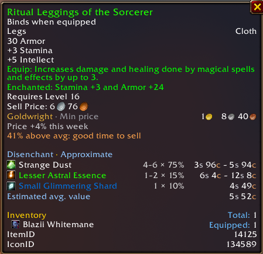

# BlazeDisenchant

BlazeDisenchant adds disenchant estimates to item tooltips in **World of Warcraft: Forever**.

- See possible materials, quantity ranges and approximate chances.
- With **Goldwright**, see material value ranges and an estimated average value weighted by the outcome chances.
- Without Goldwright, materials, quantities and chances remain visible. No configuration is needed.

Results are estimates. Special Forever estimates are marked **Unverified**. Average values use quantity-range midpoints and exclude auction fees.

Disenchant tables adapted from [Disenchantry](https://www.curseforge.com/wow/addons/disenchantry), licensed under the MIT License. See [LICENSE](LICENSE) and [NOTICE](NOTICE) for attribution.
